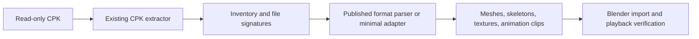

# Eureka Seven AO: Attack the Legend — Asset Extraction Research

## Objective

Extract every model and animation from the local PS3 game, preserve source provenance, and produce Blender-readable assets with verified animation playback. Reuse published format research and existing tools before implementing missing adapters. Analyze the executable only if resource inspection and public implementations cannot resolve a necessary format detail.

## Scope

- case_id: 2026-11-14-eureka-seven-ao-atl
- primary_skill: reverse-engineering
- auth.status: granted
- auth.basis: owner-operated local asset research, explicitly requested in this chat
- network_profile.mode: offline
- network_profile.notes: Game analysis is offline. Public documentation and tool source may be downloaded separately.
- in_scope.assets: the researcher-provided PS3 game directory
- output_root: the repository working directory
- out_of_scope.activities: modifying original game files, operating RPCS3, publishing game assets
- ready_for_act: true

## Source identification

- Title ID: `BLJS93011`
- Application version: `01.00`
- Main archive: `USRDIR/EurekaAODataR.cpk` in the original game directory
- Archive size: 625,807,672 bytes
- Archive signature: `43 50 4B 20` (`CPK `)
- Executable: `USRDIR/EBOOT.BIN` in the original game directory

## Research status

The initial notes below are historical. Production deliverables are under `playable/`, use Blender 5.1.2, and include models, original transform clips and supplemental native parameter curves. See [validation.md](validation.md) for final coverage and evidence, [file-formats.md](file-formats.md) for exact interpretation, and [tools-and-attribution.md](tools-and-attribution.md) for code authorship.

### 2026-11-14 — Initial triage

The main archive is a CRIWARE CPK container. No model or animation format has been identified yet. Archive extraction must precede model-format selection. Finding a CPK extractor does not establish model, skeleton, skinning, or animation support.

The live Blender MCP connection is unavailable at initial inspection. A local Blender executable will be located for isolated background conversion and playback verification.

## Existing research and tools

- [CriCodecs](https://github.com/Youjose/CriCodecs): maintained CRIWARE container tooling; investigate its CPK inspection and extraction API.
- [PyCriCodecs fork](https://github.com/t-wy/PyCriCodecs): earlier CPK implementation, useful if an existing local version is available.
- [CriPakTools implementation](https://github.com/tge-was-taken/Mod-Compendium/tree/master/Dependencies/Source/CriPakTools): alternative published CPK parser.

## Pipeline

## Completion criteria

1. Every archive entry is inventoried, with extraction failures explicitly reported.
2. Every identified model and animation is accounted for in a machine-readable manifest.
3. Blender loads the converted meshes, materials, armatures, and animation clips.
4. Playback verification evaluates representative frames and confirms actual deformation or rigid-part movement, not just successful file import.
5. Format details, offsets, conversion commands, limitations, and evidence are documented here or in linked English Markdown files.

No extraction or playback success is claimed at this stage.

### 2026-11-14 — Existing-tool selection and archive extraction

Located the installed PyCriCodecs 0.4.11 distribution and existing CRILAYLA native module. Used Youjose's existing implementations rather than writing a CPK parser. The local wrapper added path/offset/size validation, recursive extraction and per-entry hashes. Root TOC has 687 entries; recursive processing accounted for 528 containers and 4,376 entries. Original source files were not edited and RPCS3 was not operated.

### 2026-11-14 — Published Phyre parser identified

The model, motion and texture clusters start with `PHYR`, platform `GCM\0`, and contain self-describing class/member schemas. Public searches led to Julian Uy's MIT-licensed `ed8pkg2glb`. Pinned commit `c076d638e3f978afe2bb4de0a6f911f03b2afdfd` successfully exported AO's mesh, 90-joint skin and animation channels. This established that a custom executable reverse-engineering effort was unnecessary. IDA Pro / ida-pro-mcp was not used.

The local storage adapter presents `.GCM` as `.phyre` logical names and routes writes to converted output directories. Upstream files remain unmodified. All 1,301 Collada-origin clusters eventually converted: 495 mesh-bearing scenes and 1,229 animation-bearing source scenes.

### 2026-11-14 — Material/UI compatibility work

The game uses `TextureSampler` where upstream expects `DiffuseMapSampler`; a parsed-parameter alias restored color-texture assignment. Two UI textures require ARGB1555 decoding, supplied by Pillow. A 128x4 ARGB8 texture exposed an incorrect minimum-height assumption. These fixes are local adapters; they are not new upstream features.

### 2026-11-14 — Model/clip assembly and Blender version correction

Each resource folder contains at most one model scene, allowing associated animation-only scenes to be merged by exact node names. Extra controls such as the AO board helper nodes are retained. Created 495 assembled model scenes and 72 auxiliary animation scenes.

An initial Blender 4.2.1 probe preceded the user's version correction. After the explicit instruction to use 5.1, all final scenes and production verification used the separately installed Blender 5.1 executable, reporting version 5.1.2. Historical 4.2 probe files remain distinguishable from the `playable/` outputs. The live Blender MCP connection was unavailable, so isolated background CLI processes were used.

### 2026-11-14 — Source-channel completeness audit

Compared `PAnimationChannel` plus `PAnimationConstantChannel` counts against exported glTF transform channels for every source scene. Body/weapon transform channels matched. There were 459 source scenes with additional camera FOV, shader or user-attribute channels. Reused the existing parser to preserve all 1,468 additional channels as source-linked JSON. Imported them as custom-property Actions and added explicit preview bindings where meaningful.

The first Blender batch exposed 231 clips containing only native parameters: a plain TRS import produced no Action. Those were corrected by the supplemental parameter importer. Three selected preview renders also required creating a World because empty factory scenes have none. A Blender dependency-graph refresh was necessary after adding animated custom properties; source-key evaluation then passed. The corrective batch produced 567 passing scene results.

### 2026-11-14 — Visual texture audit and RSX repair

Successful import and finite mesh motion did not reveal a separate texture-layout issue. Rendered previews showed striped/corrupted atlas placement. Inspection found upstream's function named `imageUntileMorton` used an identity 8x8 tile. An initial use of the existing Vita Morton routine recovered atlas shapes but transposed the RSX axis convention. Cross-checking RPCS3's published RSX image utilities confirmed that X occupies the low interleaved bit.

The final local adapter reuses upstream `DecodeMorton2X/Y` with correct RSX axis order, supports the 128x4 texture without eight-row padding, and honors the native linear flag. RGB565 data also receives the layout correction before the existing pixel decoder. Re-decoded 1,087 scene-pack 2D textures, refreshed assembled PNGs and repacked affected Blender files. Visually inspected final AO Nirvash, ZERO and theEND renders: armor panels, face details, color accents and board markings align with the mesh.

### 2026-11-14 — Final delivery audit

`scripts/audit_delivery.py` re-hashes extracted entries and the original source archive, checks complete source-channel accounting, reopens every final Blender scene, compares packed texture bytes with corrected PNGs, checks NLA clip counts and evaluates native parameter keys after reload. Its result is recorded in `manifests/delivery-audit.json` and summarized in [validation.md](validation.md). Original game scripts, effects runtime and lip-sync packages remain raw preserved data rather than reconstructed Blender gameplay behavior.

The first reopen audit detected a native camera FOV curve offset caused by integer NLA strip-start creation. The targeted repair inspected 964 native strips and corrected 12 scenes to their exact Action bounds. The importer was fixed for clean reproductions. The final audit passed: 567 saved scenes reopened, all 74,860 identified source channels accounted for, 4,324 native-key values rechecked with zero error, and 1,077 packed image byte streams matched corrected PNGs. The original CPK and all 4,376 extracted entry hashes remained unchanged.

### 2026-11-14 — User-requested EBOOT and roster data-mining extension

The initial seven-type/ten-NPC classification still had static-mapping uncertainty. The user explicitly requested EBOOT inspection and deeper data mining. Read-only extraction through the existing scetool produced a research ELF, leaving the original untouched. An unrelated IDA instance remained untouched; a separate research IDB and MCP instance were created.

Public source search found June / `kimjh-eclipse`'s Apache-2.0 CSVB parser, pinned at `d1e54c7b41b1165970f841c3de3fd7d86cc93bdc`. Reused it to parse all 106 CSVB files without failures. Compared 18 UnitResource definitions with the corresponding 18 ordered parameter tables in five other families and all 44 stage presets. Correctly preserved duplicate/incorrect NodeParam labels rather than inventing new units from them.

Recovered ELF TOC references using pyelftools and Capstone because IDA lacked direct string xrefs for these `r2` loads. Native menu navigation, the AO 0/1 toggle and selection confirmation established **eight selectable configurations / seven named player machine types**. All ten non-player IDs occur in stage presets; no complete nineteenth unit definition was found. `esc3` is explicitly used in enemy slots and has damage/event scripts, despite having no skeletal animation in its standalone mesh.

Found two accessory model archives without a matching path in the audited typed fields/named ELF paths (`ems1_gun`, `enze_knife`) and ten missing referenced paths (nine weapon command names and one camera path). Neither category establishes a hidden full mech. A bounded semantic audit passed, with the original EBOOT hash unchanged. Full evidence, authorship, commands, addresses and static/runtime limits are in [eboot-roster-data-mining.md](eboot-roster-data-mining.md).

## 2026-11-14: Source-only repository preparation

Prepared the directory as a research source/documentation repository. Original game inputs and local model/animation outputs were preserved, with all generated data roots excluded from Git. Moved 32 historical logs, totaling 1,861,792 bytes, to an external reversible archive. Preserved useful JSON evidence locally.

Moved both complete upstream checkouts outside the project and retained only the required unmodified parser modules and original licenses. Recorded authors, repositories, commits and file hashes in `dependencies.lock.json`; updated the research audits to verify those snapshots without nested Git metadata.

Added English-only Markdown rules, a default-deny ignore allowlist, a local pre-commit hook and a staged/committed blob checker. Rewrote the README as a research entry point and replaced asset download links with plain local output paths. Repository preparation does not repeat the earlier Blender conversion or imply new runtime game testing. See [repository policy](repository-policy.md) for the exact boundary and check commands.

## 2026-11-14: Publication privacy audit

Reviewed all tracked text, reachable history and commit metadata before remote publication. Replaced workstation paths in documentation and two script defaults with environment-based examples and explicit input arguments. Commit author and committer attribution use the owner's approved Git name and GitHub noreply address. Upstream authors, licenses and research findings remain intact.

Added reusable privacy checks for publishable text and a history-audit mode. The prior unpublished Git snapshots are preserved only in a private external backup, outside the publication repository. See [security audit](security-audit.md) for scope, evidence, safeguards and limits.
